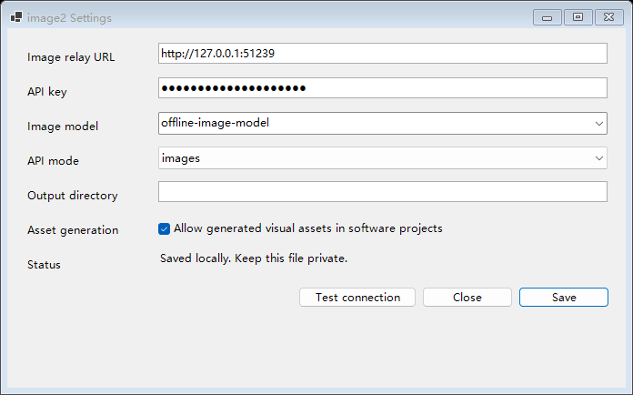

# image2 for Codex Desktop


一个面向 **Codex Desktop** 的 Windows image2 插件：连接你自己的图片中转站，完成文生图、结果检查，以及可选的软件开发素材补齐。



## 亮点

| 能力 | 说明 |
| --- | --- |
| 直接生图 | 在 Codex 中提出图片需求，插件调用独立图片中转站并保存结果 |
| 开发协作 | 可选地为网页、移动端、桌面端、游戏和其他软件项目补齐缺失位图素材 |
| 视觉验收 | 生成后检查实际文件，不把 API 成功误当成视觉合格 |
| 多种接口 | 支持 `images`、`images-stream`、`responses` 和 `chat` |
| 本地配置 | Windows 配置窗口遮蔽 API key，并支持 `/models` 检查 |
| 默认克制 | `AUTO_GENERATE_ASSETS=false`，不会在普通开发任务中自动花费生图额度 |

## 快速开始

### 1. 安装

从 [Releases](https://github.com/544244857/codex-image2-plugin/releases) 下载 `image2-codex-*.zip`，解压到一个长期保留的目录，然后运行：

```powershell
powershell -NoProfile -ExecutionPolicy Bypass -File .\Install-Codex.ps1
```

重启 Codex 或新建对话。安装脚本会注册本地 marketplace，因此解压目录需要保留。

### 2. 配置

运行独立的 Windows 配置窗口：

```powershell
powershell -NoProfile -STA -ExecutionPolicy Bypass -File .\plugins\image2\scripts\Configure.ps1
```

填写你自己的图片中转站地址、API key 和模型。例如：

```dotenv
BASE_URL=https://your-image-relay.example.com/v1
API_KEY=your-image-relay-api-key
MODEL=gpt-image-1
MODE=images
AUTO_GENERATE_ASSETS=false
```

配置文件保存在 `%USERPROFILE%\.codex\image2.env`。不要把完成后的文件提交到 GitHub。

### 3. 使用

直接告诉 Codex 你要生成什么图片即可。命令行也可以这样调用：

```powershell
powershell -NoProfile -ExecutionPolicy Bypass -File .\plugins\image2\scripts\imagegen.ps1 `
  -Prompt "极简蓝色闪电图标，白色背景" `
  -Size 1024x1024 `
  -Mode images
```

先检查请求而不发网络请求：

```powershell
powershell -NoProfile -ExecutionPolicy Bypass -File .\plugins\image2\scripts\imagegen.ps1 `
  -Prompt "test" -DryRun
```

## 适用场景

开发任务中，只有在你打开 `AUTO_GENERATE_ASSETS=true` 后，插件才会主动处理真正缺失的位图素材。它适用于：

- 网页与移动端页面的插画、封面、背景和空状态图
- 桌面应用的欢迎图、主题素材和演示资源
- 游戏中的背景、角色立绘、纹理和精灵素材
- 其他确实需要位图资产的软件项目

图标、简单几何图形、图表和已有项目资源应优先使用代码或现有资源，不必调用生图。

## 当前限制

- 当前公开版是**文生图**，不上传原图、参考图或蒙版，也不直接编辑已有图片。
- 每位用户需要自行提供图片中转站、模型名和 API key。
- 配置窗口是独立 Windows 窗口，不是 Codex 原生设置页面。
- `auto` 和 `Probe` 可能产生多次真实请求；确认接口后建议固定 `-Mode`。
- 离线测试不代表你的中转站或模型一定可用。

## 视觉验收规则

技能会要求打开实际生成文件，检查主体、外观、动作、构图、文字和明显缺陷。首次生成后最多追加五次生成请求；失败请求也计入次数，已有文件不会被覆盖。

## 开发与测试

```powershell
powershell -NoProfile -ExecutionPolicy Bypass -File .\tests\Test-Configure.ps1
```

测试使用本地 mock HTTP 服务，不调用付费图片接口。发布包使用项目外构建脚本生成，并检查 ZIP 清单、哈希和明显凭据路径。

## 隐私

- 不要提交 `%USERPROFILE%\.codex\image2.env`、API key、原始响应或生成图片。
- 插件不读取或替换 Codex 的聊天 `model_provider`。
- 图片会发送到你配置的中转站，请自行确认该服务的数据处理和留存政策。

## 项目文档

- [配置参考](docs/configuration.md)
- [贡献指南](CONTRIBUTING.md)
- [发布流程](docs/release.md)
- [最新 Release](https://github.com/544244857/codex-image2-plugin/releases/latest)

## 许可证

[MIT License](LICENSE)
